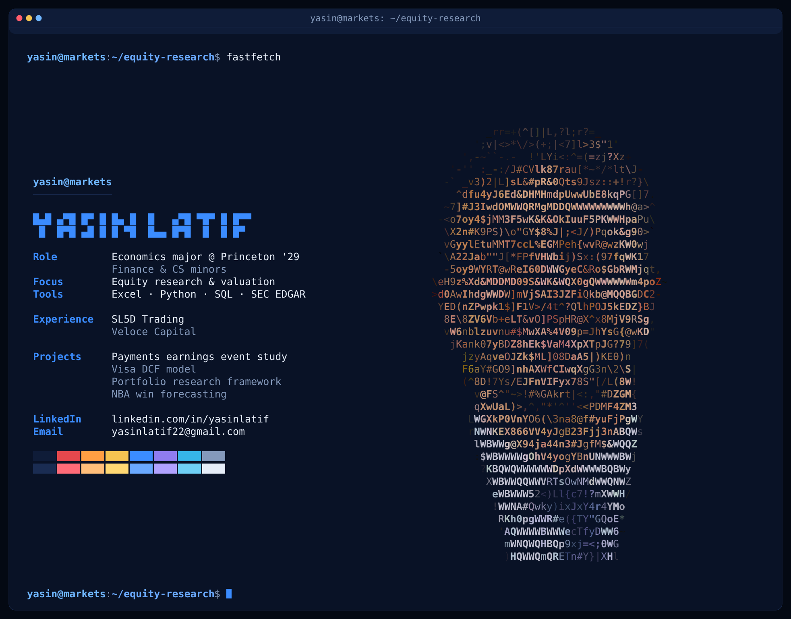

I'm an economics student at Princeton focused on equity research and valuation. I use financial modeling and Python to study businesses and test investment hypotheses.

Economics @ Princeton '29 · Finance & CS minors · [LinkedIn](https://www.linkedin.com/in/yasinlatif/) · [Email](mailto:yasinlatif22@gmail.com)

## Research direction

I'm researching systematic trading strategies, with the aim of eventually managing a small fund. My standard is to test a strategy the way I'd want it tested before risking capital: rules fixed in advance, costs included, out-of-sample evaluation, and limitations reported. No strategy of mine has passed a confirmatory test yet. A preregistered CRSP/Compustat study of a gross-profitability strategy is in progress in a private repository, because the data licence does not allow redistribution.

## Projects

- [Payments Earnings Event Study](https://github.com/yasinlatif22-cpu/payments-earnings-event-study): earnings days move six payments stocks roughly 2 to 6 times more than other days (150 events). Neither EPS surprise nor the prior 60-day run-up predicts direction. Findings are sample-specific.
- [Financial Models](https://github.com/yasinlatif22-cpu/financial-models): six-tab Excel DCF of Visa with live sensitivity tables. Work in progress, with no investment conclusion yet.
- [Portfolio Research Framework](https://github.com/yasinlatif22-cpu/portfolio-research-framework): preregistered backtest harness for a screened, concentrated long-only strategy, with costs, turnover and bootstrap confidence intervals. The only real-data run is exploratory, on survivor-biased data, and is not evidence.
- [NBA Forecasting](https://github.com/yasinlatif22-cpu/nba-forecasting): preseason win forecasts scored out of sample, with a walk-forward mean absolute error of 7.79 wins per team-season against 8.45 for a last-season baseline. About fifteen variants were compared on the same data, so treat this as optimistic.
